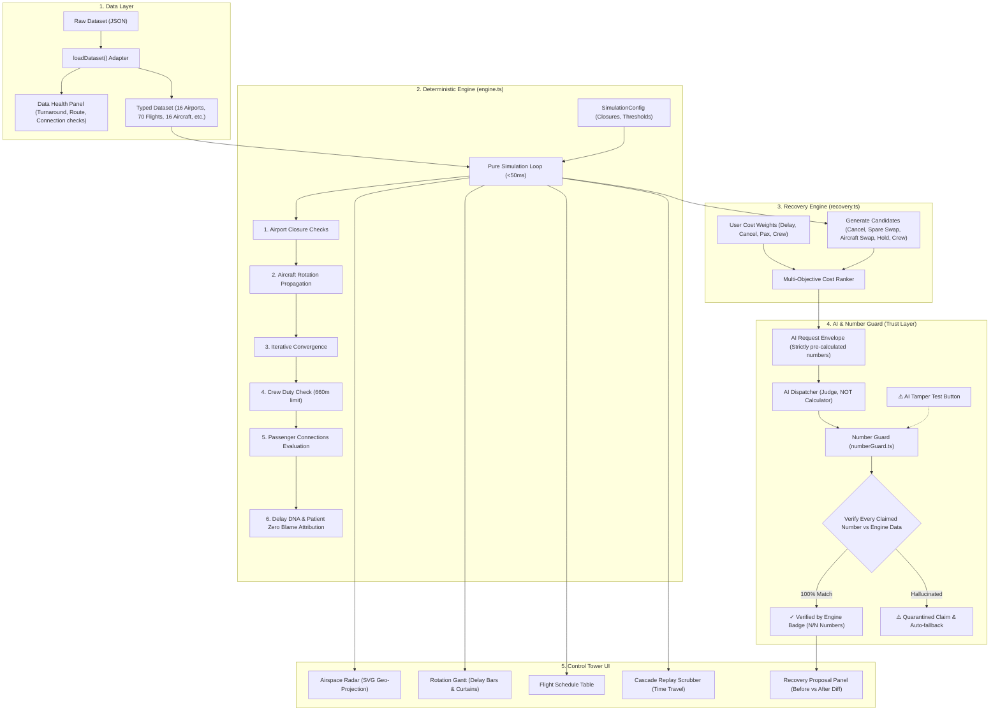

# Domino Sky: Flight Disruption Cascade & Recovery Simulator

**Domino Sky** is an interactive, control-tower grade flight disruption simulator built as a React + Vite single-page application. It models how a single localized weather event (e.g. a 90-minute storm at Mumbai) cascades through aircraft rotations, passenger connections, and crew duty windows across clear-weather cities.

---

## ⚡ Quick Start

```bash
# 1. Install dependencies
npm install

# 2. Run unit tests (14 deterministic unit tests)
npm test

# 3. Start development server
npm run dev

# 4. Or build production bundle
npm run build
```

---

## 🏗️ Architecture



---

## 🔒 Determinism Guarantee

The simulation engine is **strictly deterministic**:
$$\text{simulate}(\text{Dataset}, \text{Config}) \to \text{SimulationResult}$$

1. **Zero Randomness**: No `Math.random()`, no non-deterministic hash maps, and no asynchronous I/O inside simulation passes.
2. **Integer Minutes Representation**: All timestamps are exact integer offsets from midnight ($0 \le t \le 1439$), preventing floating-point drift.
3. **Stable Sequencing**: Rotations are processed in explicit `sequenceInRotation` order per aircraft.
4. **Conservation of Blame**: For every delayed flight, the sum of minutes in its `causeChain` exactly equals `delayMinutes`:
   $$\sum_{i=1}^{k} \text{causeChain}[i].\text{minutes} \equiv \text{flight.delayMinutes}$$
5. **Zero-Disruption Invariant**: With zero airport closures, total delays, cancellations, and missed connections are strictly $0$.

---

## 🛡️ Number Guard (Trust Layer)

LLMs frequently hallucinate numbers when summarizing numerical datasets. Domino Sky enforces a **deterministic guardrail**:
1. **Extraction**: `extractNumbers()` extracts every numeric claim from the AI's explanation using regex, filtering out flight numbers (e.g. `DS-103`), clock times (`14:00`), and ordinals (`1st`).
2. **Context Matching**: The claim's surrounding semantic tokens (e.g. *"delay"*, *"passengers"*, *"cancellations"*) are classified into categories (`delay`, `passenger`, `cancellation`, `crew`).
3. **Data Pool Verification**: The number is looked up in the engine's pre-computed pool. If found under the correct category within $\pm 1$ rounding tolerance, it is marked **Verified**.
4. **Quarantine & Fallback**: If an unverified number appears, the sentence is quarantined with `[NUMBER GUARD BLOCKED]`, and the app falls back to a template-generated explanation.
5. **Interactive Tamper Test**: Click the **"⚠️ AI Tamper Test"** button to inject a fabricated number and observe the Number Guard instantly catch and quarantine it.

---

## 🎬 2-Minute Demo Script

Follow this script to demonstrate the whole narrative:

### Step 1: Baseline Health (0:00 – 0:20)
1. Launch the app. Note the top KPI strip: **0 Delays**, **0 Cancellations**, **0 Stranded Passengers**.
2. Click **"🩺 Data Health"** in the top bar to show the normalization adapter: 16 Indian airports, 70 flights, 16 aircraft, 28 connections, 14 crews, and 4 spares validated.

### Step 2: Trigger the Cascade (0:20 – 0:50)
1. Click **"★ Seed Demo Scenario"** (or select BOM, 14:00, 90 min, and click "Disrupt").
2. The KPI strip instantly updates:
   - **Delayed flights**: ~12–14 flights
   - **Total delay minutes**: ~500–600m
   - **Missed connections**: ~3–4 connections
   - **Stranded passengers**: ~50–80 passengers
3. Look at the **Airspace Radar**: Red ripple pulse emanates from BOM. Arcs turn amber (delayed) and red (cancelled).
4. Click **"▶ Play"** on the bottom scrubber bar to watch the cascade spread outward in time from 14:00 to 20:00.

### Step 3: Inspect "Delay DNA" (0:50 – 1:20)
1. Click flight **DS-103** (or any late flight in the table or map).
2. The **Delay DNA** panel reveals its complete lineage:
   - *BOM Weather Closure (90m)* $\to$ *VT-AAA held* $\to$ *Rotation Knock-on* $\to$ *Downstream arrival late*.
   - Proportional colour-coded delay composition bar shows exact causes.
3. Review the **Patient Zero Ranking**: BOM closure ranks #1 as the root epicenter.

### Step 4: Recovery & Number Guard (1:20 – 2:00)
1. In the right panel, observe the **Engine-Computed Candidates** ranked by cost score.
2. Adjust the **Cost Function Sliders** (e.g. increase Cancellation Weight) to see candidates re-rank dynamically.
3. Click **"🤖 AI Dispatcher"**:
   - The AI evaluates options and recommends the top action.
   - Observe the green badge: **"✓ Verified by engine: N/N numbers"**.
4. Click **"⚠️ AI Tamper Test"**:
   - A wrong number is injected into the text.
   - The Number Guard immediately blocks the hallucination with a red warning.
5. Click **"✓ Apply Recovery"**:
   - Watch the live Before vs After diff update the map, Gantt chart, and KPIs with green deltas!
